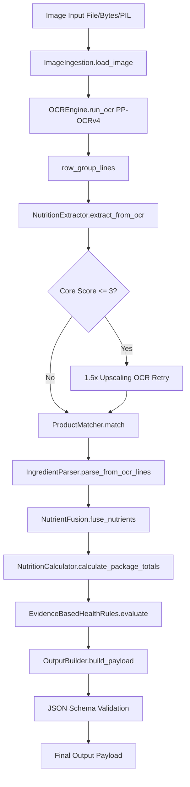
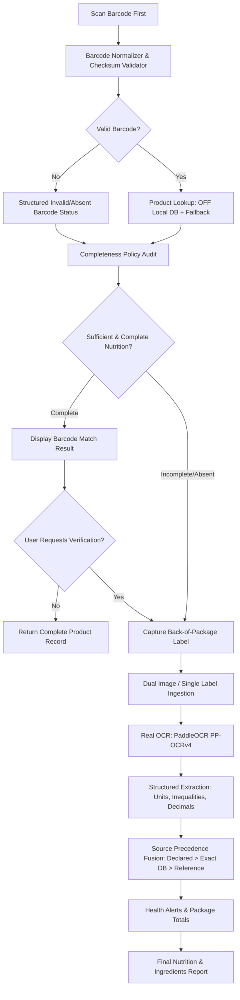

# Architecture and Usage Audit: Food Intelligence Engine
**Date:** 2026-10-24  
**Project Path:** `D:\health app\food packet scanner\food-intelligence-engine`  
**Git Baseline Commit:** `dde71098e6998253d14ccb8e8198f29649680c98`  
**Execution Environment:** Windows 10/11 x64, Python 3.13.9 (.venv), PaddleOCR PP-OCRv4, Pytest 9.1.1  

---

## 1. Executive Summary

This audit establishes the ground-truth technical state of the `food-intelligence-engine` repository before enacting the barcode-first scanner workflow, nutrition OCR enhancements, data enrichment guardrails, and safe dead-code cleanup.

### Key Audit Findings:
1. **Pipeline Orientation:**
   - Current orchestrator (`FoodIntelligenceEngine.process_image()`) is **image-first** with an optional barcode parameter.
   - The required system must be **barcode-first**, with explicit barcode validation (EAN-13, EAN-8, UPC-A, UPC-E), leading-zero preservation, checksum verification, local & remote lookup, transparent completeness policy evaluation, and seamless fallback to back-of-package label scanning.
2. **OCR Engine & Pretrained Models:**
   - Real OCR is powered by genuine PaddleOCR PP-OCRv4 (`ch_PP-OCRv4_det_infer`, `en_PP-OCRv4_rec_infer`, `ch_ppocr_mobile_v2.0_cls_infer`) running on CPU with Windows OneDNN PIR compatibility patches.
   - Text bounding boxes, confidence scores, and line deskewing are active and verified.
   - Baseline test suite passes 100% (99 passed in 76s).
3. **Plate-Food / Cooked Dishes Classifier Audit:**
   - An exhaustive audit of `src/`, `models/`, `datasets/`, and `scripts/` found **zero** files or model artifacts related to plate-food / 43-class cooked dish recognition.
   - `datasets/training` and `datasets/raw/optional_ocr_datasets` are empty.
   - The project is cleanly concentrated on packaged food labels, barcode lookup, and nutrition facts extraction.
4. **Data Assets & Local Databases:**
   - `datasets/processed/products/products.db` contains **16,592** Open Food Facts products indexed by barcode `code`, `product_name`, and `brands`.
   - `datasets/processed/nutrient_reference/nutrient_reference.db` contains **68,875** USDA Foundation Food records and **12** Indian Food Composition Tables (IFCT 2017) staple records.
5. **Nutrition Extraction & Difficult Edge Cases:**
   - `structured.py` provides bounding-box aware column alignment, unit normalization, %DV exclusion, and row separation.
   - Inequality detection (`<1 g`, `≤ 0.5 g`) is partially flagged in `Candidate.upper_bound` but needs explicit representation in data schemas and output payloads without converting `<1 g` to `1 g`.
   - Missing fields are properly retained as `None` with `status: "missing"` and are never silently converted to `0.0`.

---

## 2. Actual Runtime Flow Analysis

### Current Runtime Flow (`process_image`)

### Proposed Barcode-First Runtime Flow

---

## 3. Component Dependency and Usage Map

| Component / File | Purpose | Execution Path | Dependencies & Consumers | Recommendation | Risk & Verification Method |
| :--- | :--- | :--- | :--- | :--- | :--- |
| `src/food_engine/engine.py` | Unified end-to-end pipeline coordinator | **Active Production** | Consumes all sub-modules | **Enhance**: Add `scan_barcode()`, separate label image ingestion, completeness checks | Low risk; verify with unit & integration tests |
| `src/food_engine/ocr/ocr_engine.py` | PaddleOCR PP-OCRv4 wrapper with deskew and MKLDNN fix | **Active Production** | Consumed by `engine.py`, benchmark scripts | **Keep**: Working genuine OCR on image pixels | Low risk; verified on 22 real photos |
| `src/food_engine/ocr/image_ingestion.py` | Image loading, EXIF rotation, format check | **Active Production** | Consumed by `engine.py`, `ocr_engine.py` | **Keep**: Robust image loading | Low risk; tested on PNG/JPEG/bytes |
| `src/food_engine/ocr/layout_assembly.py` | Merges OCR fragments sharing print row | **Active Production** | Consumed by `engine.py` | **Keep**: Tested row grouping | Low risk; tests pass |
| `src/food_engine/nutrition_extraction/structured.py` | Geometry-aware nutrition table extraction | **Active Production** | Consumed by `extractor.py`, `engine.py` | **Enhance**: Ensure inequality (`<1 g`) bounds and explicit unit preservation | Low risk; test against 24 scenarios |
| `src/food_engine/nutrition_extraction/extractor.py` | Regex fallback extraction & basis detection | **Active Production** | Consumed by `structured.py`, `engine.py` | **Keep & Refine**: Locale decimal parsing, salt/sodium ratio | Low risk; test decimal comma/point |
| `src/food_engine/ingredient_parser/parser.py` | Ingredients and allergen parser | **Active Production** | Consumed by `engine.py` | **Enhance**: Support separate ingredient image lines, additives | Low risk; test nested parenthesis |
| `src/food_engine/product_matching/matcher.py` | Hierarchical product matcher (barcode -> name -> ref) | **Active Production** | Consumed by `engine.py` | **Enhance**: Barcode normalization (leading zeros) & checksums | Low risk; test with known barcodes |
| `src/food_engine/product_matching/nutrient_fusion.py` | Provenance-aware nutrient merger & conflict detector | **Active Production** | Consumed by `engine.py` | **Enhance**: Strict precedence enforcement (declared > exact DB > ref) | Low risk; verified non-overwriting |
| `src/food_engine/nutrition_calculation/calculator.py` | Package totals and unit conversions | **Active Production** | Consumed by `engine.py` | **Keep**: Deterministic calculations | Low risk; tests pass |
| `src/food_engine/reporting/health_rules.py` | WHO/FSSAI evidence-based nutrient alerts | **Active Production** | Consumed by `engine.py` | **Keep**: Explainable warnings without medical claims | Low risk; tested |
| `src/food_engine/reporting/output_builder.py` | Schema payload assembly & validation | **Active Production** | Consumed by `engine.py` | **Enhance**: Format badges, barcode status, inequality flags | Low risk; schema compliant |
| `src/food_engine/validation/__init__.py` | Empty module | Unused (0 bytes) | None | **Utilize**: House `barcode_validator.py` and `completeness.py` | Zero risk |
| `src/food_engine/data_ingestion/download_manager.py` | Verified resumable downloader with hash check | Utility / Ingestion | Standalone CLI & scripts | **Keep**: Cleanly isolated download manager | Low risk |
| `scripts/probe_off.py` | Ad-hoc network probe script | Exploratory | None | **Isolate / Archive**: Internal scratch utility | Zero risk to production |
| `scripts/probe_sources.py` | Ad-hoc network probe script | Exploratory | None | **Isolate / Archive**: Internal scratch utility | Zero risk to production |
| `scripts/run_verified_benchmark.py` | Phase 6/7 verified benchmark runner | Evaluation / Verification | Core QA harness | **Keep**: Essential for benchmark integrity | Zero risk to production |

---

## 4. Production vs Experimental vs Obsolete Code

1. **Production Core (Keep & Strengthen):**
   - `src/food_engine/engine.py`
   - `src/food_engine/ocr/*`
   - `src/food_engine/nutrition_extraction/*`
   - `src/food_engine/ingredient_parser/*`
   - `src/food_engine/product_matching/*`
   - `src/food_engine/nutrition_calculation/*`
   - `src/food_engine/reporting/*`
2. **New Architecture Modules to Add in `src/food_engine/validation/`:**
   - `src/food_engine/validation/barcode_validator.py`: Normalization and checksum calculation for EAN-13, EAN-8, UPC-A, UPC-E.
   - `src/food_engine/validation/completeness.py`: Transparent completeness policy auditing identity, energy, macros, ingredients, and basis.
3. **Exploratory / Diagnostic Scripts (Archive / Retain without deletion):**
   - `scripts/probe_off.py`, `scripts/probe_sources.py`: Retain as diagnostic utilities or archive into `scripts/archive/` if cleanup requested.

---

## 5. Verification Gate Status
- Baseline Git status: clean.
- Unit/Integration test suite: **99 passed, 0 failed, 1 warning in 76.19s**.
- Model weights: verified in `models/paddleocr/`.
- Local databases: verified in `datasets/processed/` (16,592 products, 68,887 reference foods).
